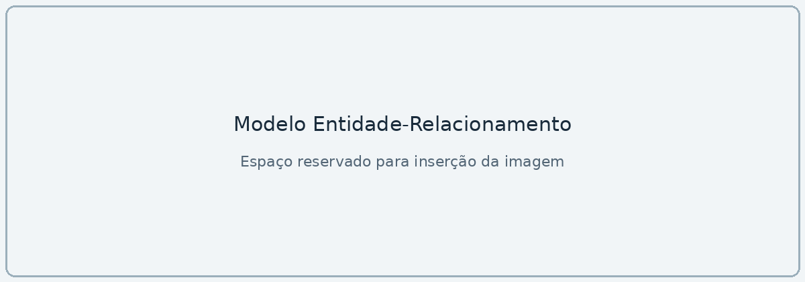

::: {.pf-resumo}
Cada item mostra o resultado e, logo abaixo, o trecho para copiar. Todos os recursos funcionam
sem internet: os widgets ficam em `widgets/`, o Observable JS e o Mermaid são embutidos pelo Quarto
e os shields são SVG locais.
:::

## Como usar este catálogo

1. Abra o bloco **Código para copiar** do recurso desejado e cole no capítulo.
2. Ajuste textos, parâmetros e dados conforme indicado em **Ajustes**.
3. Execute `quarto render` (ou `source("build.R")`) e confira a página.

::: {.callout-important}
## Regras para os widgets em iframe

- O `id` do iframe deve ser `frame-<id do widget>`; é ele que permite o ajuste automático de altura
  feito pelo script incluído em todas as páginas via `include-after-body` no `_quarto.yml`.
- Use a classe `pf-frame`: borda, cantos e altura mínima seguem o tema claro ou escuro.
- O PDF não executa JavaScript. Envolva o iframe em `content-visible when-format="html"` e,
  se desejar, escreva um texto alternativo em `content-visible unless-format="html"`.
- Widgets largos ficam melhores em `.column-page`, que usa a largura disponível além da coluna de texto.
- Para criar um widget novo, copie um arquivo de `widgets/`, mantenha a chamada
  `PF.autoResize('<id>')` (ou o `postMessage` equivalente) e use o mesmo `id` no iframe.
:::

## Widgets de validação e métricas

### Divisão treino/teste

Partição aleatória versus estratificada, composição das partições e variação da prevalência em 300 sorteios.

::: {.content-visible when-format="html"}
:::: {.column-page}
```{=html}
<iframe id="frame-split-treino-teste" class="pf-frame" src="widgets/split_treino_teste.html"
  title="Divisão treino e teste" loading="lazy"></iframe>
```
::::
:::

::: {.callout-tip collapse="true"}
## Código para copiar

````markdown
::: {.content-visible when-format="html"}
:::: {.column-page}
```{=html}
<iframe id="frame-split-treino-teste" class="pf-frame" src="widgets/split_treino_teste.html"
  title="Divisão treino e teste" loading="lazy"></iframe>
```
::::
:::

::: {.content-visible unless-format="html"}
Recurso interativo disponível na versão HTML.
:::
````

**Ajustes:** valores iniciais nos atributos `value` dos controles em `widgets/split_treino_teste.html`;
textos de leitura na função `render()`.
:::

### Validação cruzada K-fold

Rodadas, dobras de validação, ROC-AUC por dobra, média e desvio-padrão, e comparação com um holdout único.

::: {.content-visible when-format="html"}
:::: {.column-page}
```{=html}
<iframe id="frame-validacao-cruzada" class="pf-frame" src="widgets/validacao_cruzada.html"
  title="Validação cruzada K-fold" loading="lazy"></iframe>
```
::::
:::

::: {.callout-tip collapse="true"}
## Código para copiar

````markdown
::: {.content-visible when-format="html"}
:::: {.column-page}
```{=html}
<iframe id="frame-validacao-cruzada" class="pf-frame" src="widgets/validacao_cruzada.html"
  title="Validação cruzada K-fold" loading="lazy"></iframe>
```
::::
:::
````

**Ajustes:** limites de K, N, prevalência e separação nos controles `range`; número de repetições
na variável `reps`.
:::

### ROC-AUC

Distribuição dos escores por classe, limiar móvel, curva ROC, matriz de confusão e AUC teórica $\Phi(d/\sqrt{2})$.

::: {.content-visible when-format="html"}
:::: {.column-page}
```{=html}
<iframe id="frame-roc-auc" class="pf-frame" src="widgets/roc_auc.html"
  title="Curva ROC e ROC-AUC" loading="lazy"></iframe>
```
::::
:::

::: {.callout-tip collapse="true"}
## Código para copiar

````markdown
::: {.content-visible when-format="html"}
:::: {.column-page}
```{=html}
<iframe id="frame-roc-auc" class="pf-frame" src="widgets/roc_auc.html"
  title="Curva ROC e ROC-AUC" loading="lazy"></iframe>
```
::::
:::
````

**Ajustes:** tamanho da amostra na constante `N`; cores em `PF.COLORS` (`widgets/pf-metrics.js`).
:::

### PR-AUC

Curva precisão-revocação, linha de base igual à prevalência, precisão média (AP) e efeito da prevalência
sobre PR-AUC e ROC-AUC.

::: {.content-visible when-format="html"}
:::: {.column-page}
```{=html}
<iframe id="frame-pr-auc" class="pf-frame" src="widgets/pr_auc.html"
  title="Curva precisão-revocação e PR-AUC" loading="lazy"></iframe>
```
::::
:::

::: {.callout-tip collapse="true"}
## Código para copiar

````markdown
::: {.content-visible when-format="html"}
:::: {.column-page}
```{=html}
<iframe id="frame-pr-auc" class="pf-frame" src="widgets/pr_auc.html"
  title="Curva precisão-revocação e PR-AUC" loading="lazy"></iframe>
```
::::
:::
````

**Ajustes:** prevalências da varredura no vetor `prevs`; demais parâmetros como no widget ROC.
:::

## Widgets de métodos e arquitetura

### Leaderboard de modelos

Tabela ordenável com filtro, barras proporcionais e realce de latência (estilo `formattable`).

::: {.content-visible when-format="html"}
:::: {.column-page}
```{=html}
<iframe id="frame-formattable" class="pf-frame" src="widgets/formattable_leaderboard.html"
  title="Leaderboard de modelos" loading="lazy"></iframe>
```
::::
:::

::: {.callout-tip collapse="true"}
## Código para copiar

````markdown
::: {.content-visible when-format="html"}
:::: {.column-page}
```{=html}
<iframe id="frame-formattable" class="pf-frame" src="widgets/formattable_leaderboard.html"
  title="Leaderboard de modelos" loading="lazy"></iframe>
```
::::
:::
````

**Ajustes:** substitua o vetor `ROWS` pelos resultados reais (pode ser exportado do R com
`jsonlite::toJSON()`).
:::

### Contrato JSON Schema e DAG de prevenção de vazamento

Validador de payload com cenários prontos e grafo das etapas do pipeline.

::: {.content-visible when-format="html"}
:::: {.column-page}
```{=html}
<iframe id="frame-contract-dag" class="pf-frame" src="widgets/contract_pipeline.html"
  title="Validador de contrato e DAG" loading="lazy"></iframe>
```
::::
:::

::: {.callout-tip collapse="true"}
## Código para copiar

````markdown
::: {.content-visible when-format="html"}
:::: {.column-page}
```{=html}
<iframe id="frame-contract-dag" class="pf-frame" src="widgets/contract_pipeline.html"
  title="Validador de contrato e DAG" loading="lazy"></iframe>
```
::::
:::
````

**Ajustes:** contrato em `CONTRACT`, cenários em `PRESETS`, etapas em `DAG_STAGES`.
:::

### Reamostragem ADASYN + NearMiss: fluxo conceitual

Narrativa em cinco passos com gráfico, tabela sincronizada e chamada em R. Bilíngue (PT/EN).

::: {.content-visible when-format="html"}
:::: {.column-page}
```{=html}
<iframe id="frame-sby-conceptual" class="pf-frame" src="widgets/sbyadanear_conceptual.html"
  title="Fluxo conceitual ADASYN e NearMiss" loading="lazy" style="min-height:760px"></iframe>
```
::::
:::

::: {.callout-tip collapse="true"}
## Código para copiar

````markdown
::: {.content-visible when-format="html"}
:::: {.column-page}
```{=html}
<iframe id="frame-sby-conceptual" class="pf-frame" src="widgets/sbyadanear_conceptual.html"
  title="Fluxo conceitual ADASYN e NearMiss" loading="lazy" style="min-height:760px"></iframe>
```
::::
:::
````

**Ajustes:** pontos em `BASE_RECORDS` e `SYNTHETIC_RECORDS`; textos em `I18N`.
:::

### Motor numérico AVX-512 e oneMKL

Simulação passo a passo do DGEMM em registradores ZMM, memória, cache e guarda de cancelamento.

::: {.content-visible when-format="html"}
:::: {.column-page}
```{=html}
<iframe id="frame-sby-avx512" class="pf-frame" src="widgets/sbyadanear_avx512.html"
  title="Motor numérico AVX-512 e oneMKL" loading="lazy" style="min-height:780px"></iframe>
```
::::
:::

::: {.callout-tip collapse="true"}
## Código para copiar

````markdown
::: {.content-visible when-format="html"}
:::: {.column-page}
```{=html}
<iframe id="frame-sby-avx512" class="pf-frame" src="widgets/sbyadanear_avx512.html"
  title="Motor numérico AVX-512 e oneMKL" loading="lazy" style="min-height:780px"></iframe>
```
::::
:::
````

**Ajustes:** matrizes em `RAW_QUERIES`, `RAW_REFS` e `REF_CLASSES`.
:::

### Gradient Boosting Playground

Construção aditiva da fronteira com profundidade, taxa de aprendizado, subamostragem e Newton-Raphson.

::: {.content-visible when-format="html"}
:::: {.column-page}
```{=html}
<iframe id="frame-gb-playground" class="pf-frame" src="widgets/gb_playground.html"
  title="Gradient Boosting Playground" loading="lazy" style="min-height:610px"></iframe>
```
::::
:::

::: {.callout-tip collapse="true"}
## Código para copiar

````markdown
::: {.content-visible when-format="html"}
:::: {.column-page}
```{=html}
<iframe id="frame-gb-playground" class="pf-frame" src="widgets/gb_playground.html"
  title="Gradient Boosting Playground" loading="lazy" style="min-height:610px"></iframe>
```
::::
:::
````
:::

### SuperTree: inspeção de árvores

Distribuição por nó, limiares de corte e exportação em SVG.

::: {.content-visible when-format="html"}
:::: {.column-page}
```{=html}
<iframe id="frame-supertree" class="pf-frame" src="widgets/supertree_inspector.html"
  title="SuperTree" loading="lazy" style="min-height:580px"></iframe>
```
::::
:::

::: {.callout-tip collapse="true"}
## Código para copiar

````markdown
::: {.content-visible when-format="html"}
:::: {.column-page}
```{=html}
<iframe id="frame-supertree" class="pf-frame" src="widgets/supertree_inspector.html"
  title="SuperTree" loading="lazy" style="min-height:580px"></iframe>
```
::::
:::
````

**Ajustes:** estrutura das árvores no vetor `TREES` (pode ser exportada de um modelo XGBoost).
:::

## Widget embutido na página (sem iframe)

Útil para controles pequenos que herdam o tema do site. Exemplo: score ponderado de qualidade de dados.

::: {.content-visible when-format="html"}
```{=html}
<div class="pf-inline" id="pf-dq-widget">
  <label>Completude (%) · peso 3
    <input type="range" min="0" max="100" step="0.1" value="99.2" data-weight="3" aria-label="Completude">
    <span class="pf-value"></span></label>
  <label>Validade (%) · peso 2
    <input type="range" min="0" max="100" step="0.1" value="98.4" data-weight="2" aria-label="Validade">
    <span class="pf-value"></span></label>
  <label>Unicidade (%) · peso 1
    <input type="range" min="0" max="100" step="0.1" value="100" data-weight="1" aria-label="Unicidade">
    <span class="pf-value"></span></label>
  <div>Score global: <output aria-live="polite"></output></div>
</div>
<script>
(function(){
  const root = document.getElementById("pf-dq-widget");
  const inputs = root.querySelectorAll("input");
  const fmt = v => v.toLocaleString("pt-BR", {minimumFractionDigits: 1, maximumFractionDigits: 2}) + "%";
  const update = () => {
    let total = 0, weights = 0;
    for(const input of inputs){
      total += Number(input.value) * Number(input.dataset.weight);
      weights += Number(input.dataset.weight);
      input.parentElement.querySelector(".pf-value").textContent = fmt(Number(input.value));
    }
    root.querySelector("output").textContent = fmt(total / weights);
  };
  inputs.forEach(i => i.addEventListener("input", update));
  update();
})();
</script>
```
:::

::: {.callout-tip collapse="true"}
## Código para copiar

````markdown
::: {.content-visible when-format="html"}
```{=html}
<div class="pf-inline" id="meu-widget">
  <label>Indicador A (%) · peso 3
    <input type="range" min="0" max="100" step="0.1" value="99.2" data-weight="3">
    <span class="pf-value"></span></label>
  <label>Indicador B (%) · peso 1
    <input type="range" min="0" max="100" step="0.1" value="95" data-weight="1">
    <span class="pf-value"></span></label>
  <div>Resultado: <output aria-live="polite"></output></div>
</div>
<script>
(function(){
  const root = document.getElementById("meu-widget");
  const inputs = root.querySelectorAll("input");
  const fmt = v => v.toLocaleString("pt-BR", {maximumFractionDigits: 2}) + "%";
  const update = () => {
    let total = 0, weights = 0;
    for(const input of inputs){
      total += Number(input.value) * Number(input.dataset.weight);
      weights += Number(input.dataset.weight);
      input.parentElement.querySelector(".pf-value").textContent = fmt(Number(input.value));
    }
    root.querySelector("output").textContent = fmt(total / weights);
  };
  inputs.forEach(i => i.addEventListener("input", update));
  update();
})();
</script>
```
:::
````

**Ajustes:** troque o `id` (único na página), os rótulos, pesos e a fórmula em `update()`.
:::

## Observable JS

Blocos `{ojs}` rodam no navegador com o runtime embutido pelo Quarto. Duas regras garantem o
funcionamento sem internet:

- **Importe `Inputs`, `html`, `svg` e `md` do módulo local** `widgets/ojs-offline.js` uma vez por página,
  com `//| output: false`.
  Sem essa linha, o Quarto busca esses módulos em CDN. Evite `require()` e `import` de pacotes externos.
- Como o projeto usa `execute: eval: false`, mantenha `//| eval: true` nas células OJS
  (e `%%| eval: true` no Mermaid).

```{ojs}
//| echo: false
//| eval: true
//| output: false
import {Inputs, html, svg, md} from "/widgets/ojs-offline.js"
```

::: {.callout-tip collapse="true"}
## Código para copiar (uma vez por página)

````markdown
```{ojs}
//| echo: false
//| eval: true
//| output: false
import {Inputs, html, svg, md} from "/widgets/ojs-offline.js"
```
````

O caminho iniciado por `/` é resolvido a partir da raiz do projeto e funciona em qualquer pasta.
:::

### Controles e tabela reativa

```{ojs}
//| echo: false
//| eval: true
viewof nFolds = Inputs.range([2, 10], {value: 5, step: 1, label: "Dobras (K)"})
viewof nTotal = Inputs.range([1000, 50000], {value: 10000, step: 1000, label: "Registros (N)"})
Inputs.table(Array.from({length: nFolds}, (_, i) => ({
  dobra: `Dobra ${i + 1}`,
  treino: Math.round(nTotal * (nFolds - 1) / nFolds),
  validacao: Math.round(nTotal / nFolds)
})))
```

::: {.callout-tip collapse="true"}
## Código para copiar

````markdown
```{ojs}
//| echo: false
//| eval: true
viewof nFolds = Inputs.range([2, 10], {value: 5, step: 1, label: "Dobras (K)"})
viewof nTotal = Inputs.range([1000, 50000], {value: 10000, step: 1000, label: "Registros (N)"})
Inputs.table(Array.from({length: nFolds}, (_, i) => ({
  dobra: `Dobra ${i + 1}`,
  treino: Math.round(nTotal * (nFolds - 1) / nFolds),
  validacao: Math.round(nTotal / nFolds)
})))
```
````
:::

### Gráfico SVG reativo sem bibliotecas externas

Curva ROC binormal teórica para a separação escolhida.

```{ojs}
//| echo: false
//| eval: true
viewof dSep = Inputs.range([0, 3.5], {value: 1.5, step: 0.1, label: "Separação d"})
phiN = x => {
  const z = Math.abs(x) / Math.SQRT2, t = 1 / (1 + 0.3275911 * z);
  const e = 1 - (((((1.061405429 * t - 1.453152027) * t) + 1.421413741) * t - 0.284496736) * t + 0.254829592) * t * Math.exp(-z * z);
  return x >= 0 ? 0.5 * (1 + e) : 0.5 * (1 - e);
}
rocPath = {
  const pts = [];
  for(let c = 6; c >= -6; c -= 0.05) pts.push([1 - phiN(c), 1 - phiN(c - dSep)]);
  return pts.map(([x, y], i) => `${i ? "L" : "M"}${(30 + x * 240).toFixed(1)},${(250 - y * 240).toFixed(1)}`).join(" ");
}
svg`<svg viewBox="0 0 290 270" width="320">
  <rect x="30" y="10" width="240" height="240" fill="none" stroke="currentColor" stroke-opacity=".3"/>
  <path d="M30,250 L270,10" stroke="currentColor" stroke-opacity=".35" stroke-dasharray="4 4"/>
  <path d="${rocPath}" fill="none" stroke="#2a9d8f" stroke-width="3"/>
  <text x="150" y="268" text-anchor="middle" font-size="11" fill="currentColor">TFP</text>
  <text x="150" y="235" text-anchor="middle" font-size="13" fill="currentColor">AUC = ${phiN(dSep / Math.SQRT2).toFixed(3)}</text>
</svg>`
```

::: {.callout-tip collapse="true"}
## Código para copiar

````markdown
```{ojs}
//| echo: false
//| eval: true
viewof dSep = Inputs.range([0, 3.5], {value: 1.5, step: 0.1, label: "Separação d"})
// funções auxiliares e dados calculados a partir dos controles
rocPath = { /* gere o atributo d do path a partir de dSep */ }
svg`<svg viewBox="0 0 290 270" width="320"> ... <path d="${rocPath}"/> ... </svg>`
```
````

**Dica:** para dados vindos do R, grave um JSON ou CSV no projeto e leia com
`FileAttachment("dados/arquivo.csv").csv({typed: true})`; o arquivo é copiado para o site.
:::

## Componentes Quarto

### Caixas de destaque (callouts)

::: {.callout-note}
## Nota
Informação complementar.
:::

::: {.callout-tip}
## Dica
Boa prática recomendada.
:::

::: {.callout-warning}
## Atenção
Risco ou limitação conhecida.
:::

::: {.callout-important collapse="true"}
## Detalhe recolhível
Conteúdo que o leitor abre quando precisar.
:::

::: {.callout-tip collapse="true"}
## Código para copiar

````markdown
::: {.callout-note}
## Título
Texto.
:::

::: {.callout-important collapse="true"}
## Título recolhível
Texto oculto até o clique.
:::
````

Tipos disponíveis: `note`, `tip`, `warning`, `caution`, `important`. Use `appearance="simple"` para
uma versão discreta.
:::

### Abas

::: {.panel-tabset}
#### R
```r
modelo <- PredictiveFactoryRun(contrato)
```

#### SQL
```sql
SELECT * FROM ML_MODEL_REGISTRY WHERE STATUS = 'PROMOTED';
```

#### Bash
```bash
quarto render
```
:::

::: {.callout-tip collapse="true"}
## Código para copiar

````markdown
::: {.panel-tabset}
#### Aba 1
Conteúdo.

#### Aba 2
Conteúdo.
:::
````
:::

### Equações numeradas e referência cruzada

$$
\mathrm{AUC} = P\left(S^{+} > S^{-}\right) = \int_0^1 \mathrm{TVP}\,\mathrm{d}(\mathrm{TFP})
$$ {#eq-exemplo-auc}

$$
\mathrm{AP} = \sum_{k} \left(R_k - R_{k-1}\right) P_k
$$ {#eq-exemplo-ap}

A @eq-exemplo-auc define a ROC-AUC e a @eq-exemplo-ap, a precisão média.

::: {.callout-tip collapse="true"}
## Código para copiar

````markdown
$$
\mathrm{AUC} = P\left(S^{+} > S^{-}\right)
$$ {#eq-auc}

Conforme a @eq-auc, ...
````

As equações são renderizadas em MathML, sem MathJax nem internet.
:::

### Figura com ampliação e legenda

{#fig-exemplo width=70%}

A @fig-exemplo abre em tela cheia ao clique (`lightbox: auto` no `_quarto.yml`).

::: {.callout-tip collapse="true"}
## Código para copiar

````markdown
{#fig-nome width=80%}

Veja a @fig-nome.
````
:::

### Tabela com referência cruzada

| Métrica | Sensível à prevalência | Uso |
|---|:---:|---|
| ROC-AUC | Não | Ordenação geral |
| PR-AUC | Sim | Eventos raros |
| F1 | Sim | Limiar escolhido |

: Exemplo de tabela numerada. {#tbl-exemplo}

A @tbl-exemplo resume as métricas.

::: {.callout-tip collapse="true"}
## Código para copiar

````markdown
| Coluna A | Coluna B |
|---|---|
| valor | valor |

: Legenda da tabela. {#tbl-nome}
````
:::

### Diagramas Mermaid

```{mermaid}
%%| eval: true
%%| fig-width: 6.5
flowchart LR
  A[Contrato JSON] --> B[Particionamento]
  B --> C[Pré-processamento<br/>na dobra]
  C --> D[Balanceamento]
  D --> E[Ajuste e tuning]
  E --> F[(Registro do modelo)]
```

::: {.callout-tip collapse="true"}
## Código para copiar

````markdown
```{mermaid}
%%| eval: true
flowchart LR
  A[Etapa 1] --> B[Etapa 2]
  B --> C[(Banco)]
```
````

O Mermaid é embutido pelo Quarto e desenhado no navegador. Também aceita `sequenceDiagram`,
`erDiagram`, `stateDiagram-v2` e `gantt`.
:::

### Código com anotações

```r
resultado <- PredictiveFactoryRun(
  contrato = contrato,          # <1>
  semente  = 2026L              # <2>
)
```
1. Contrato validado pelo JSON Schema.
2. Semente fixa para reprodutibilidade.

::: {.callout-tip collapse="true"}
## Código para copiar

````markdown
```r
f(x = 1)   # <1>
```
1. Explicação da linha marcada.
````
:::

### Notas na margem e notas de rodapé

Texto principal com uma nota de rodapé.[^nota]

[^nota]: As notas aparecem ao passar o cursor.

::: {.column-margin}
**Nota na margem.** Comentários curtos, definições ou referências rápidas.
:::

::: {.callout-tip collapse="true"}
## Código para copiar

````markdown
Texto com nota.[^id]

[^id]: Conteúdo da nota.

::: {.column-margin}
Comentário na margem.
:::
````

Para figuras ou tabelas largas, use `.column-page` ou `.column-screen-inset`.
:::

### Citações

A curva ROC é descrita por @fawcett2006 e a relação com a curva PR por @davis2006.
Em bases desbalanceadas, ver @saito2015.

::: {.callout-tip collapse="true"}
## Código para copiar

````markdown
Segundo @chave2024, ... ou entre parênteses [@chave2024; @outra2025, p. 10].
````

As chaves ficam em `referencias.bib` e o estilo ABNT em `abnt.csl`.
:::

### Atalhos de teclado e ícones

Pressione  para pré-visualizar no RStudio.
Ícones Bootstrap, já incluídos no Quarto: <i class="bi bi-cpu"></i> <i class="bi bi-database"></i>
<i class="bi bi-diagram-3"></i> <i class="bi bi-shield-check"></i>.

::: {.callout-tip collapse="true"}
## Código para copiar

````markdown
{}
<i class="bi bi-cpu"></i>
````

Nomes dos ícones: pasta `bootstrap-icons` do Quarto ou o arquivo `bootstrap-icons.css` em `_site/site_libs`.
:::

### Cartões, resumo e espaço reservado

::: {.pf-resumo}
**Resumo do capítulo.** Use no início de cada capítulo para orientar a leitura.
:::

::: {.pf-placeholder}
Espaço reservado para figura ou conteúdo futuro.
:::

::: {.callout-tip collapse="true"}
## Código para copiar

````markdown
::: {.pf-resumo}
Resumo do capítulo.
:::

::: {.pf-cards}
::: {.pf-card}
<i class="bi bi-cpu"></i>

#### [Título](arquivo.qmd)

Descrição curta.
:::
:::

::: {.pf-placeholder}
Espaço reservado.
:::
````
:::

### Shields (badges) offline

::: {.content-visible when-format="html"}

:::

::: {.callout-tip collapse="true"}
## Como alterar

Edite a tabela no início de `scripts/badges.R` (arquivo, rótulo, valor, cor e grupo) e execute
`Rscript scripts/badges.R`. Os SVG são gravados em `images/badges/` e o fragmento `_badges.qmd`
é atualizado. Para usar um shield isolado:

````markdown

````
:::

### Conteúdo exclusivo do HTML ou do PDF

::: {.callout-tip collapse="true"}
## Código para copiar

````markdown
::: {.content-visible when-format="html"}
Somente no site (widgets, iframes, Observable JS).
:::

::: {.content-visible when-format="pdf"}
Somente no PDF (texto alternativo, figura estática).
:::
````
:::
